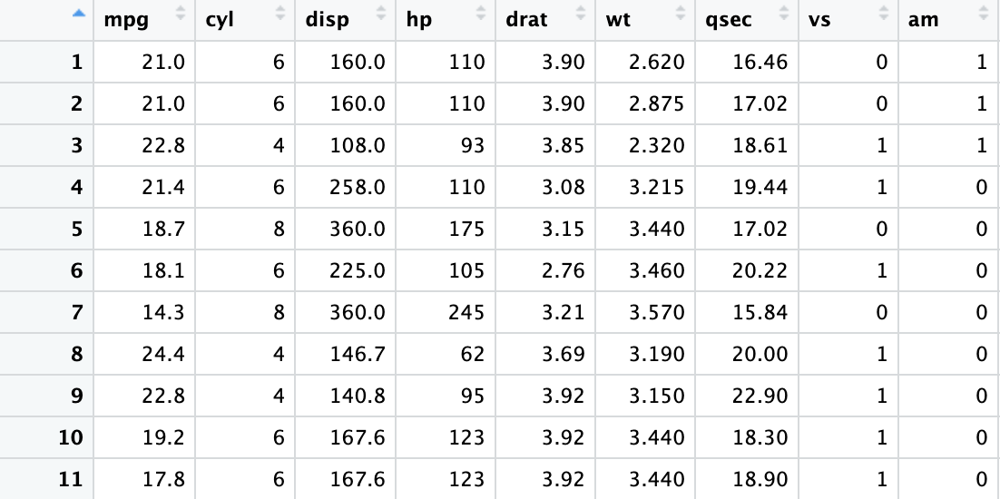

\newcommand{\bh}{\hat{\beta}}
\newcommand{\hqxx}{\hat{\mathbf{Q}}_{XX}}
\newcommand{\hqxy}{\hat{\mathbf{Q}}_{XY}}
\newcommand{\bX}{\mathbf{X}}
\newcommand{\bY}{\mathbf{Y}}
\newcommand{\bP}{\mathbf{P}}
\newcommand{\bM}{\mathbf{M}}
\newcommand{\spn}{\operatorname{span}}
\newcommand{\rank}{\operatorname{rank}}

## 0 估計式與估計值

在進入普通最小平方法（Ordinary Least Squares,
OLS）之前，先把「估計」這件事的三個角色講清楚：

-   **Estimand（欲估參數）**：母體（population）中我們真正想知道的參數。
-   **Estimator（估計式）**：用樣本（sample）計算出來、用來猜 estimand
    的函數；它本身是隨機變數。
-   **Estimate（估計值）**：給定一份已經實現的樣本後，估計式算出來的具體數字。

估計的任務，就是設計一個「有根據的猜測」：用樣本資料構造
estimator，盡可能接近 estimand。

#### 線性回歸中的 estimand 是什麼？

在筆記 1（母體版本）我們把線性回歸看成一個**最佳線性預測（best linear
predictor, BLP）**問題：用 $X$ 的線性函數去預測 $Y$。

令 $X$ 為 $k\times 1$ 隨機向量，$Y$ 為隨機變數。

\begin{align*}
    Y,\quad 
    X = \begin{pmatrix}
        X^1 \\
        \vdots \\
        X^k
    \end{pmatrix}
\end{align*}

我們在母體中定義

```{=tex}
\begin{align}
S(\beta) := \mathbb{E}\big[(Y - X'\beta)^2\big],
\qquad
\beta := \arg\min_{\beta\in\mathbb{R}^k} S(\beta).
\end{align}
```
在這個角度下，**線性回歸的 estimand 就是母體投影係數（projection
coefficient）**$\beta$。它是母體分配決定的非隨機量。

一般條件下，$\beta$ 可以寫成：[^1]

[^1]: Regularity condition：假設
    $\mathbb{E}\|X\|^2<\infty$、$\mathbb{E}|Y|^2<\infty$，且
    $\mathbb{E}[XX']$ 可逆（非奇異）。

::: {.callout-note icon="false"}
```{=tex}
\begin{align}
\beta
= \mathbb{E}[XX']^{-1}\mathbb{E}[XY].
\end{align}
```
:::


## 1 一般最小平方法

現在我們回到「樣本」的世界。假設我們從母體（population）中抽出一組隨機樣本（random sample）。直觀上，樣本就是母體隨機變數 $(Y, X)$ 的一組實現值（realization）。

樣本包含 $n$ 筆觀察值：

\begin{align}
(Y_1, X_1), \ldots, (Y_n, X_n).
\end{align}

例如第 $i$ 筆觀察值是 $(Y_i, X_i)$。其中 $Y_i$ 是一個標量，而 $X_i$ 是 $k\times 1$ 的向量：

\begin{align}
Y_i \in \mathbb{R},
\qquad
X_i=
\begin{pmatrix}
X_i^1\\
\vdots\\
X_i^k
\end{pmatrix}.
\end{align}

::: {.callout-note icon="false"}
## Sample Mean（樣本平均）
隨機向量 $X$ 的樣本平均（sample mean）定義為

\begin{align}
\bar X := \frac{1}{n}\sum_{i=1}^n X_i.
\end{align}

:::

接下來我們再引入兩個常用記號。首先，將 $X_iY_i$ 視為一個 $k\times 1$ 的向量（因為 $Y_i$ 是標量），它的樣本平均定義為

\begin{align}
\underset{k\times 1}{\hqxy}
:= \frac{1}{n}\sum_{i=1}^n X_iY_i.
\end{align}

再來，將 $X_iX_i'$ 視為一個 $k\times k$ 的矩陣，它的樣本平均定義為

\begin{align}
\underset{k\times k}{\hqxx}
:= \frac{1}{n}\sum_{i=1}^n X_iX_i'.
\end{align}

#### 最小平方問題

延續母體版本的最佳預測問題 $\min_\beta \mathbb{E}(Y-X'\beta)^2$
。因為母體分佈未知，所以用**樣本類比（sample analogues / plug-in
principle）**把期望換成樣本平均。

給定樣本 $\{(Y_i, X_i)\}_{i=1}^n$，定義樣本目標函數

```{=tex}
\begin{align}
\hat S(\beta)
:= \frac{1}{n}\sum_{i=1}^n (Y_i - X_i'\beta)^2,
\qquad
\hat\beta := \arg\min_{\beta\in\mathbb{R}^k}\hat S(\beta).
\end{align}
```
這個 $\hat\beta$ 就是 OLS estimator；樣本實現後算出來的數字是 OLS
estimate。

### 推導 OLS 估計式

為了推導，常把 $n$ 倍的目標函數寫成平方和（sum of squared errors,
SSE）：

```{=tex}
\begin{align}
\mathrm{SSE}(\beta)
:= \sum_{i=1}^n (Y_i - X_i'\beta)^2.
\end{align}
```

:::{.callout-tip icon="false"}
## 簡單回歸的OLS估計式

考慮最常見的簡單線性迴歸（simple linear regression），把 $X_i$ 視為**單一解釋變數**（scalar），並且一定包含截距：

\begin{align}
\hat\alpha,\hat\beta
:= \arg\min_{\alpha,\beta\in\mathbb{R}}
\sum_{i=1}^n (Y_i-\alpha-\beta X_i)^2.
\end{align}

令

\begin{align}
Q(\alpha,\beta) := \sum_{i=1}^n (Y_i-\alpha-\beta X_i)^2
\end{align}

為平方和目標函數。對 $\alpha$、$\beta$ 分別做一階條件（first-order condition, FOC）：

對 $\alpha$：

\begin{align}
\frac{\partial Q(\alpha,\beta)}{\partial \alpha}
&= -2\sum_{i=1}^n (Y_i-\alpha-\beta X_i)=0 \\
\Longrightarrow\quad
\sum_{i=1}^n Y_i - n\alpha - \beta\sum_{i=1}^n X_i &= 0 \\
\Longrightarrow\quad
\hat\alpha &= \bar Y - \hat\beta\,\bar X,
\end{align}

其中 $\bar X=\frac{1}{n}\sum_i X_i$、$\bar Y=\frac{1}{n}\sum_i Y_i$。

把 $\hat\alpha=\bar Y-\hat\beta\bar X$ 代回原式，對 $\beta$ 的 FOC 可化簡為

\begin{align}
\sum_{i=1}^n (X_i-\bar X)(Y_i-\bar Y)
-
\hat\beta\sum_{i=1}^n (X_i-\bar X)^2
=0,
\end{align}

因此得到斜率估計式

\begin{align}
\hat\beta
=
\frac{\sum_{i=1}^n (X_i-\bar X)(Y_i-\bar Y)}{\sum_{i=1}^n (X_i-\bar X)^2}.
\end{align}

最後再用 $\hat\alpha=\bar Y-\hat\beta\bar X$ 求得截距估計式：

\begin{align}
\hat\alpha = \bar Y - \hat\beta\,\bar X.
\end{align}

:::


比較斜率係數的估計式：

與母體回歸的係數:

OLS估計式就是母體參數的樣本對應。


:::{.callout-tip icon="false"}
## 多變量回歸的OLS估計式

令 $X_i$ 為 $k\times 1$ 向量（預設已經包含常數項，亦即 $X_i$
的第一個分量是 1），OLS 定義為

```{=tex}
\begin{align}
\hat\beta := \arg\min_{\beta\in\mathbb{R}^k}\sum_{i=1}^n (Y_i - X_i'\beta)^2.
\end{align}
```
把 SSE 展開：

```{=tex}
\begin{align}
\mathrm{SSE}(\beta)
&=\sum_{i=1}^n Y_i^2
-2\beta'\sum_{i=1}^n X_iY_i
+\beta'\left(\sum_{i=1}^n X_iX_i'\right)\beta.
\end{align}
```
對 $\beta$ 微分並令其為零，得到正常方程： [^2]

[^2]: Regularity condition：假設 $\sum_{i=1}^n X_iX_i'$
    可逆。直觀上是樣本中的解釋變數沒有完全共線性（no perfect
    multicollinearity）。

```{=tex}
\begin{align}
\sum_{i=1}^n X_iX_i'\,\hat\beta =
\sum_{i=1}^n X_iY_i.
\end{align}
```
若 $\sum_{i=1}^n X_iX_i'$ 可逆，就有閉式解 

\begin{align}
\hat\beta
=
\left(\sum_{i=1}^n X_iX_i'\right)^{-1}
\left(\sum_{i=1}^n X_iY_i\right).
\end{align}

:::

到這裡我們先暫停一下，釐清一個常見的困惑：$\bh$ 到底是什麼？

可以把它理解成「同一個符號，站在不同角度有不同身分」：

- $\bh$ 是最小平方法（least squares）問題的**解（solution）**：它讓平方殘差和最小。
- $\bh$ 是隨機樣本 $\{(Y_i,X_i)\}_{i=1}^n$ 的**函數**。因為每一筆 $(Y_i,X_i)$ 都是隨機變數，所以由它們算出來的 $\bh$ 也必然是**隨機變數（random variable）**。
- $\bh$ 是母體投影係數 $\beta$ 的**估計式（estimator）**。注意 $\beta$ 是母體分配決定的參數，因此是**非隨機（non-random）**的。
- 一旦樣本已經實現（realized），把資料代入後得到的那個具體數字，就是 $\beta$ 的**估計值（estimate）**：也就是我們用資料做出的猜測。

未來我們會討論估計式$\hat \beta$的性質時，都會將$\hat \beta$視為一個隨機變數。

## 2 OLS 殘差項

OLS 做完之後，會自然產生「擬合值」與「殘差」，它們在後續推導（例如
$R^2$、變異數估計）會一直出現。

::: {.callout-note icon="false"}
## Fitted value（擬合值）

定義第 $i$ 筆的擬合值（fitted value）為

```{=tex}
\begin{align}
\hat Y_i := X_i'\hat\beta.
\end{align}
```
:::

::: {.callout-note icon="false"}
## Residual（殘差）

定義第 $i$ 筆的殘差（residual）為

```{=tex}
\begin{align}
\hat e_i := Y_i - \hat Y_i = Y_i - X_i'\hat\beta.
\end{align}
```
:::

**$e_i$ 和 $\hat e_i$有何不同？**

$e_i$ 和 $\hat e_i$ 的差別在於：一個是「母體投影誤差」，另一個是「樣本殘差」。兩者看起來形式相近，但概念與可觀測性不同。

注意，投影**誤差**（error）$e_i$ 定義為

\begin{align}
e_i = Y_i - X_i'\beta,
\end{align}

其中 $X_i'\beta$ 是線性條件期望（linear conditional expectation）或最佳線性預測（best linear predictor, BLP）。因為 $\beta$ 是母體物件，且 $X_i'\beta$ 在一般情況下無法直接觀察（我們不知道母體的投影係數），所以 $e_i$ 也就**不可觀測**。

相對地，**殘差**（residual）$\hat e_i$ 是 $Y_i$ 相對於樣本擬合值（fitted value）$\hat Y_i$ 的偏離：

\begin{align}
\hat e_i = Y_i - \hat Y_i = Y_i - X_i'\hat\beta.
\end{align}

因為 $\hat\beta$ 是用樣本資料算出來的，所以 $\hat Y_i$ 與 $\hat e_i$ 都是**可觀測**的。

之後我們會討論 OLS 估計式的變異數（variance）。理論上的變異數會牽涉到母體誤差 $e_i$；但在實作上，因為 $e_i$ 看不到，我們通常用殘差 $\hat e_i$ 來近似或估計誤差的大小。


以下是殘差項的一個種要性質：

::: {.callout-tip icon="false"}
## 性質：$\sum_{i=1}^n X_i\hat e_i = 0$

```{=tex}
\begin{align}
\sum_{i=1}^n X_i\hat e_i = 0.
\end{align}
```
**證明：**

```{=tex}
\begin{align}
\frac{1}{n}\sum_{i=1}^n X_i\hat e_i
&= \frac{1}{n}\sum_{i=1}^n X_i(Y_i-X_i'\hat\beta)\\
&= \frac{1}{n}\sum_{i=1}^n X_iY_i
- \left(\frac{1}{n}\sum_{i=1}^n X_iX_i'\right)\hat\beta.
\end{align}
```
而 $\hat\beta$ 正是由正常方程

```{=tex}
\begin{align}
\left(\sum_{i=1}^n X_iX_i'\right)\hat\beta = \sum_{i=1}^n X_iY_i
\end{align}
```
解出，所以兩項相消，得到 0。
:::

這個性質可以把它看成母體性質 $\mathbb{E}[Xe]=0$ 的樣本類比：母體投影誤差
$e:=Y-X'\beta$ 與 $X$ 正交；樣本殘差 $\hat e$ 與樣本中的 $X$ 也正交。


## 3 OLS 矩陣版本

到這裡為止，我們一直用「逐筆觀察值」的寫法（$X_i, Y_i$）。矩陣表示法會把這些疊起來，直接看出
OLS 的投影結構。

#### 介紹矩陣表示法

把資料堆疊成

```{=tex}
\begin{align}
\mathbf{Y} :=
\begin{pmatrix}
Y_1\\ \vdots\\ Y_n
\end{pmatrix}\in\mathbb{R}^{n},
\qquad
\mathbf{X}:=
\begin{pmatrix}
X_1'\\ \vdots\\ X_n'
\end{pmatrix}\in\mathbb{R}^{n\times k}.
\end{align}
```
則 OLS 估計式可寫成[^3]

[^3]: Regularity condition：假設 $\mathbf{X}'\mathbf{X}$ 可逆，等價於
    $\mathbf{X}$ 的欄向量線性獨立（full column
    rank），也就是沒有完全共線性。
    
    
\begin{align*}
    \bX = \begin{pmatrix}
        X_1^1 & X_1^2&\cdots & X_1^k \\
        \vdots &\vdots &\ddots & \vdots \\
        X_n^1 & X_n^2 &\cdots & X_n^k,
    \end{pmatrix}
\end{align*}

$\mathbf{X}$矩陣就是資料儲存在試算表中的樣子，只要回想自己使用Microsoft Excel的經驗就不會記錯了。


樣本平均可以用矩陣改寫：

\begin{align*}
    \hqxx = \frac{1}{n} \sum_{i=1}^{n} X_i X_i' = \frac{1}{n} \bX' \bX \\
    \hqxy = \frac{1}{n} \sum_{i=1}^{n} X_i Y_i = \frac{1}{n} \bX' \bY.
\end{align*}

因此我們可以用新定義的矩陣重新表達OLS估計式：

```{=tex}
\begin{align}
\hat\beta = (\mathbf{X}'\mathbf{X})^{-1}\mathbf{X}'\mathbf{Y}.
\end{align}
```

並且可以把「擬合值 + 殘差」寫成一行：

```{=tex}
\begin{align}
\mathbf{Y} = \mathbf{X}\hat\beta + \hat{\mathbf{e}},
\end{align}
```
其中

```{=tex}
\begin{align}
\hat{\mathbf{Y}} := \mathbf{X}\hat\beta,
\qquad
\hat{\mathbf{e}} := \mathbf{Y}-\hat{\mathbf{Y}}.
\end{align}
```

## 4 OLS的幾何意義：線性投影

矩陣記號的一個重要好處，是它能把 \gls{ols} 的運作看成「投影（projection）」：$\hat y=\bP y$，殘差 $\hat u=\bM y$。不過要看懂這個幾何圖像，需要先熟悉兩個線性代數概念：欄空間與秩。

::: {.callout-note icon="false"}
## Column Space（行空間）
矩陣 $\bX$ 的行空間（column space）是指：由 $\bX$ 的各個欄向量所能形成的所有線性組合所構成的集合。等價地，它是所有形如 $\bX v$ 的向量集合：

\begin{align}
\spn(\bX) 
= \left\{\, \bX v \ \middle|\ v\in\mathbb{R}^k \,\right\}.
\end{align}

直觀上，$\spn(\bX)$ 描述了「用回歸式右手邊（regressors）能生成的所有方向」。
:::

::: {.callout-note icon="false"}
## Rank（秩）
矩陣 $\bX$ 的秩（rank）是其欄空間的維度（dimension）：

\begin{align}
\rank(\bX) = \dim\big(\spn(\bX)\big).
\end{align}

向量空間的維度可以理解為：要用多少個**線性獨立（linearly independent）**的向量，才能張成（span）整個空間。
:::


線性轉換（linear transformation）$T$ 是一種線性函數，將向量空間 $V$ 中的向量映射到另一個向量空間 $W$：

\begin{align}
T: V \to W.
\end{align}

投影（projection）是一種特別重要的線性轉換：它把向量 $u$「丟到」某個子空間（subspace）上，留下在該子空間方向上的成分。

為了建立直覺，我們先回顧高中學過的「投影到一直線」的情形。

::: {.callout-note icon="false"}
## Remark：投影到一直線
回想高中向量幾何：向量 $u$ 投影到向量 $v$ 所張成的直線上，其投影為

\begin{align}
\operatorname{Proj}_v u
= v \frac{v'u}{v'v},
\end{align}

其中 $v'u$ 是 $v$ 與 $u$ 的內積（inner product）。
:::
 
 
一旦你把「投影」和「最小平方」連起來，就會發現：\gls{ols} 的核心其實是幾何。

更精確地說，ols 的擬合值 $\hat{\bY}=\bX\bh$ 是把 $\bY$ 投影到 $\bX$ 的欄空間（column space）$\mathrm{col}(\bX)$ 上的結果。也就是說，存在一個投影矩陣（projection matrix）$\bP$ 使得

\begin{align}
\hat{\bY}=\bX\bh=\bP\bY,
\qquad
\bP := \bX(\bX'\bX)^{-1}\bX'.
\end{align}

把 ols 估計式 $\bh=(\bX'\bX)^{-1}\bX'\bY$ 代回去，就得到
\begin{align}
\bX\bh = \bX(\bX'\bX)^{-1}\bX'\bY.
\end{align}

對照高中「投影到一直線」的公式
$\operatorname{Proj}_v u = v \frac{v'u}{v'v}$，你會看到完全類似的結構：在多維情況下，$\bX$ 扮演「方向」的角色，而 $(\bX'\bX)^{-1}$ 則扮演 $\frac{1}{v'v}$ 的角色，負責把內積的尺度調整到正確的大小。
    

#### $P$ 矩陣（projection matrix）

::: {.callout-note icon="false"}
## Projection matrix（投影矩陣）

定義

```{=tex}
\begin{align}
\mathbf{P} := \mathbf{X}(\mathbf{X}'\mathbf{X})^{-1}\mathbf{X}'.
\end{align}
```
:::

它把任意向量投影到 $\mathrm{span}(\mathbf{X})$（$\mathbf{X}$
的欄空間）上。特別地，

```{=tex}
\begin{align}
\hat{\mathbf{Y}} = \mathbf{X}\hat\beta = \mathbf{P}\mathbf{Y}.
\end{align}
```

**條列** $\mathbf{P}$ 的性質： 

1.**冪等（idempotent）**：$\mathbf{P}^2=\mathbf{P}$\
2. **對稱（symmetric）**：$\mathbf{P}'=\mathbf{P}$\
3.**秩（rank）相同**：$\mathrm{rank}(\mathbf{P})=\mathrm{rank}(\mathbf{X})$

直覺上：投影一次之後，再投影一次不會改變結果（所以冪等）。

### $M$ 矩陣（annihilator / residual-maker）

::: {.callout-note icon="false"}
## Annihilator matrix（消去矩陣）

定義

```{=tex}
\begin{align}
\mathbf{M} := \mathbf{I}-\mathbf{P}.
\end{align}
```
:::

它把向量投影到 $\mathrm{span}(\mathbf{X})$ 的正交補空間上。因此

```{=tex}
\begin{align}
\hat{\mathbf{e}} = \mathbf{Y}-\hat{\mathbf{Y}} = (\mathbf{I}-\mathbf{P})\mathbf{Y} = \mathbf{M}\mathbf{Y}.
\end{align}
```

**條列** $\mathbf{M}$ 的性質：

1. **冪等**：$\mathbf{M}^2=\mathbf{M}$\
2. **對稱**：$\mathbf{M}'=\mathbf{M}$\
3. **消去** $\mathbf{X}$：$\mathbf{M}\mathbf{X}=0$（所以殘差對所有
regressor 正交）\
4. **互斥投影**：$\mathbf{P}\mathbf{M}=\mathbf{M}\mathbf{P}=0$，且
$\mathbf{P}+\mathbf{M}=\mathbf{I}$


## 5 衡量擬合(Fit)的指標：R-squared

$R^2$（決定係數，R-squared）是在樣本內衡量「擬合程度」的指標。它把 $Y$
的變動分成「能被回歸解釋的部分」與「剩下解釋不了的部分」。

先定義三個平方和（都以「偏離樣本平均」為基準）：

-   總平方和（total sum of squares, TSS）

```{=tex}
\begin{align}
    \mathrm{TSS} := \sum_{i=1}^n (Y_i-\bar Y)^2.
    \end{align}
```
-   殘差平方和（residual sum of squares, RSS）

```{=tex}
\begin{align}
    \mathrm{RSS} := \sum_{i=1}^n \hat e_i^2.
    \end{align}
```
-   解釋平方和（explained sum of squares, ESS）

```{=tex}
\begin{align}
    \mathrm{ESS} := \sum_{i=1}^n (\hat Y_i-\bar Y)^2.
    \end{align}
```


這一段把 $R^2$ 放回「投影幾何」來理解：OLS 把 $y$ 分解成「投影到回歸子空間的部分」與「剩下的殘差部分」，兩者互相垂直。

#### 平方和分解與畢氏定理

畢氏定理：$\|\mathbf{Y}\|^2 = \|\mathbf{P}\mathbf{Y}\|^2 + \|\mathbf{M}\mathbf{Y}\|^2$

由

```{=tex}
\begin{align}
\mathbf{Y} = \mathbf{P}\mathbf{Y} + \mathbf{M}\mathbf{Y}
\end{align}
```
且
$\mathbf{P}\mathbf{Y}\perp \mathbf{M}\mathbf{Y}$（投影與殘差正交），得到「平方長度可分解」：

::: {.callout-tip icon="false"}
## 畢氏定理（在 OLS 投影分解下）

```{=tex}
\begin{align}
\|\mathbf{Y}\|^2 = \|\mathbf{P}\mathbf{Y}\|^2 + \|\mathbf{M}\mathbf{Y}\|^2.
\end{align}
```
**證明：**

\begin{align}
\|\mathbf{Y}\|^2
&= (\mathbf{P}\mathbf{Y}+\mathbf{M}\mathbf{Y})'(\mathbf{P}\mathbf{Y}+\mathbf{M}\mathbf{Y})\\
&= \|\mathbf{P}\mathbf{Y}\|^2 + \|\mathbf{M}\mathbf{Y}\|^2 + 2(\mathbf{P}\mathbf{Y})'(\mathbf{M}\mathbf{Y}).
\end{align} 

而 

\begin{align}
(\mathbf{P}\mathbf{Y})'(\mathbf{M}\mathbf{Y})
= \mathbf{Y}'\mathbf{P}'\mathbf{M}\mathbf{Y}
= \mathbf{Y}'\mathbf{P}\mathbf{M}\mathbf{Y}
= 0,
\end{align}

因為 $\mathbf{P}\mathbf{M}=0$。故結論成立。
:::

因為擬合向量 $\hat y$ 與殘差向量 $\hat u$ 正交（$\hat y \perp \hat u$），所以有畢氏定理

\begin{align}
\|y\|^2 = \|\hat y\|^2 + \|\hat u\|^2.
\end{align}

用投影矩陣 $\bP$ 與消去矩陣 $\bM$（$\bP=\bX(\bX'\bX)^{-1}\bX'$，$\bM=\bI-\bP$）寫，就是

\begin{align}
y'y = y'\bP y + y'\bM y.
\end{align}

### 去均值與「總變異」（含截距的情形）

若模型包含截距，最自然的「總變異」是以樣本平均為中心來衡量。令

\begin{align}
\bar y := \frac{1}{n}\mathbf 1'y,
\qquad
y_c := y - \bar y\,\mathbf 1.
\end{align}

定義**總平方和**（total sum of squares）

\begin{align}
\mathrm{SST}
:= \sum_{i=1}^n (y_i-\bar y)^2
= \|y_c\|^2
= y_c'y_c,
\end{align}

以及**殘差平方和**（sum of squared errors）

\begin{align}
\mathrm{SSE}
:= \|\hat u\|^2
= \|\bM y\|^2
= y'\bM y.
\end{align}

在「含截距」的情況下，經典的平方和分解成立：

\begin{align}
\mathrm{SST} = \mathrm{SSR} + \mathrm{SSE},
\end{align}

其中

\begin{align}
\mathrm{SSR}
:= \sum_{i=1}^n (\hat y_i-\bar y)^2
\end{align}

是回歸所「解釋」的那部分平方和。

[^1]: Regularity condition：這組分解以「模型包含截距」為前提，等價於常數向量 $\mathbf 1\in \mathrm{col}(\bX)$，從而殘差對常數也正交（例如 $\mathbf 1'\hat u=0$）。

#### $R^2$ 的定義與幾何意義

在含截距的情況下，定義

\begin{align}
R^2 := 1-\frac{\mathrm{SSE}}{\mathrm{SST}}.
\end{align}

它的幾何解釋很直接：

- $\mathrm{SST}$ 是把 $y$ 的平均成分拿掉後（去均值）的平方長度，也就是「均值中心化後的總變異」。
- $\mathrm{SSE}$ 是把 $y$ 投影到 $\mathrm{col}(\bX)$ 之後，剩下那個殘差向量的平方長度。

所以 $R^2$ 就是：**回歸子空間能解釋掉的（均值中心化）變異比例**。

**為什麼加入解釋變數會讓 $R^2$ 上升*？*

加入新的解釋變數，會讓 $\mathrm{col}(\bX)$ 變大（子空間擴張）。投影到更大的子空間，不可能讓殘差變長，因此

\begin{align}
\mathrm{col}(\bX)\ \text{變大}
\ \Rightarrow\ 
\mathrm{SSE}\ \text{弱下降}
\ \Rightarrow\ 
R^2\ \text{弱上升}.
\end{align}

